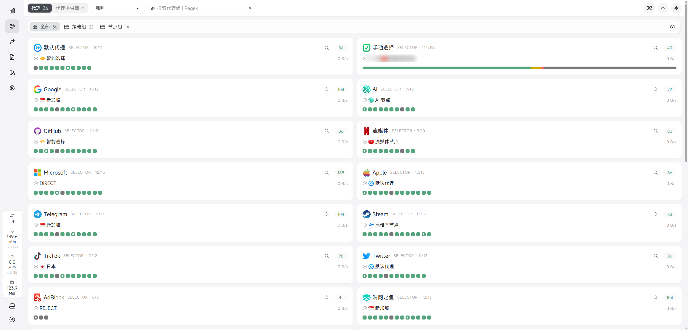

# 🚀 mihomo 自用配置合集

一组面向不同场景的 mihomo 配置模板，覆盖 **多客户端本地导入**、**Docker / NAS 局域网共享** 和 **Smart 内核智能择优**。

下载后填入自己的机场订阅即可使用。

> 🔐 配置中的订阅链接、密钥均为占位内容。真实订阅 token 等同于账号凭证，请勿将填写后的配置公开。
> 
---

## ⚔️ 配置横向对比

| 对比项 | 🧩 [`mihomo.yaml`](./mihomo.yaml) | 🐳 [`mihomo-standard-lan.yaml`](./mihomo-standard-lan.yaml) | 🧠 [`mihomo-smart-nas.yaml`](./mihomo-smart-nas.yaml) |
| :--- | :--- | :--- | :--- |
| **推荐** | ⭐⭐⭐⭐⭐ 通用首选 | ⭐⭐⭐⭐ Docker 标准版 | ⭐⭐⭐⭐⭐ Smart 用户 |
| **适用内核** | Mihomo / Clash.Meta | Mihomo / Clash.Meta | vernesong/mihomo Smart |
| **部署方式** | 客户端导入 / 裸内核 | Docker / NAS | Docker / NAS |
| **混合端口** | `7890` | `7890` | `7893` |
| **面板控制** | 🖥️ 客户端接管 | 🌐 `0.0.0.0:9090` | 🌐 `0.0.0.0:9090` |
| **自动择优组** | `url-test` | `url-test` | 🧠 `smart` |
| **Smart 组数量** | ❌ 0 | ❌ 0 | ✅ 11 |
| **策略组总数** | 36 | 36 | 36 |
| **规则集 / 路由规则** | 39 / 39 | 39 / 39 | 39 / 39 |
| **DNS 防泄漏** | ✅ `fake-ip` | ✅ `fake-ip` | ✅ `fake-ip` |
| **广告拦截** | ✅ `AdBlock` | ✅ `AdBlock` | ✅ `AdBlock` |
| **流媒体分流** | ✅ | ✅ | ✅ |
| **TUN** | 💤 默认关闭（`mixed`） | 💤 默认关闭（`system`） | ⚪ 未启用 |
| **局域网共享** | ⚠️ 需客户端开启 | ✅ | ✅ |
| **文件大小** | 36.0 KB | 35.7 KB | 35.1 KB |
| **适合人群** | 桌面 / 移动客户端用户 | 标准 mihomo Docker 用户 | 使用 Smart 内核的 NAS 用户 |

> 🎯 不知道选哪个？普通用户选 `mihomo.yaml`；Docker 标准内核选 `mihomo-standard-lan.yaml`；Smart 内核选 `mihomo-smart-nas.yaml`。

---

## 🧠 策略组

点击展开查看三个文件的完整策略组列表：

> 🏷️ 图例：👆 `select` · ♻️ `url-test` · 🧠 `smart` · ⚖️ `load-balance`

🧩 mihomo.yaml & 🐳 mihomo-standard-lan.yaml · 策略组 (36个)

| 名称 | 类型 |
| :--- | :--- |
| 👆 默认代理 | `select` |
| 👆 手动选择 | `select` |
| ♻️ 智能选择 | `url-test` |
| ⚖️ 负载均衡 | `load-balance` |
| 👆 Google | `select` |
| 👆 AI | `select` |
| 👆 GitHub | `select` |
| 👆 流媒体 | `select` |
| 👆 Microsoft | `select` |
| 👆 Apple | `select` |
| 👆 Telegram | `select` |
| 👆 Steam | `select` |
| 👆 TikTok | `select` |
| 👆 Twitter | `select` |
| 👆 AdBlock | `select` |
| 👆 漏网之鱼 | `select` |
| 👆 香港 | `select` |
| ♻️ 香港-自动择优 | `url-test` |
| 👆 日本 | `select` |
| ♻️ 日本-自动择优 | `url-test` |
| 👆 美国 | `select` |
| ♻️ 美国-自动择优 | `url-test` |
| 👆 新加坡 | `select` |
| ♻️ 新加坡-自动择优 | `url-test` |
| 👆 台湾省 | `select` |
| ♻️ 台湾省-自动择优 | `url-test` |
| 👆 AI 节点 | `select` |
| ♻️ AI 节点-自动择优 | `url-test` |
| 👆 流媒体节点 | `select` |
| ♻️ 流媒体节点-自动择优 | `url-test` |
| 👆 低倍率节点 | `select` |
| ♻️ 低倍率节点-自动择优 | `url-test` |
| 👆 高倍率节点 | `select` |
| ♻️ 高倍率节点-自动择优 | `url-test` |
| 👆 其他节点 | `select` |
| ♻️ 其他节点-自动择优 | `url-test` |

🧠 mihomo-smart-nas.yaml · 策略组 (36个)

| 名称 | 类型 |
| :--- | :--- |
| 👆 默认代理 | `select` |
| 👆 手动选择 | `select` |
| 🧠 智能选择 | `smart` |
| ⚖️ 负载均衡 | `load-balance` |
| 👆 Google | `select` |
| 👆 AI | `select` |
| 👆 GitHub | `select` |
| 👆 流媒体 | `select` |
| 👆 Microsoft | `select` |
| 👆 Apple | `select` |
| 👆 Telegram | `select` |
| 👆 Steam | `select` |
| 👆 TikTok | `select` |
| 👆 Twitter | `select` |
| 👆 AdBlock | `select` |
| 👆 漏网之鱼 | `select` |
| 👆 香港 | `select` |
| 🧠 香港-智能选择 | `smart` |
| 👆 日本 | `select` |
| 🧠 日本-智能选择 | `smart` |
| 👆 美国 | `select` |
| 🧠 美国-智能选择 | `smart` |
| 👆 新加坡 | `select` |
| 🧠 新加坡-智能选择 | `smart` |
| 👆 台湾省 | `select` |
| 🧠 台湾省-智能选择 | `smart` |
| 👆 AI 节点 | `select` |
| 🧠 AI 节点-智能选择 | `smart` |
| 👆 流媒体节点 | `select` |
| 🧠 流媒体节点-智能选择 | `smart` |
| 👆 低倍率节点 | `select` |
| 🧠 低倍率节点-智能选择 | `smart` |
| 👆 高倍率节点 | `select` |
| 🧠 高倍率节点-智能选择 | `smart` |
| 👆 其他节点 | `select` |
| 🧠 其他节点-智能选择 | `smart` |

---

## 🧠 Smart 内核说明

### ⚔️ smart 与 url-test 的区别

| 组类型 | 选择依据 | 特点 |
| :--- | :--- | :--- |
| `url-test` | 当前延迟 | 实现简单，但延迟抖动时容易频繁切换 |
| `smart` | 成功率、延迟、流量、时长等历史表现 | 更稳定，使用时间越长效果越好 |

### 💡 使用建议

- 🌍 同一个 smart 组内尽量放同一地区、质量相近的节点
- 🕐 冷启动阶段样本不足，会退化为常规探测，使用一段时间后趋于稳定
- ⚙️ 普通用户保持 `uselightgbm: false`、`collectdata: false` 即可
- 🧪 启用 LightGBM 需要同时修改 `uselightgbm: true` 并配置 `lgbm-*` 选项

---

## ⚠️ 免责声明

- 📚 本项目仅为 mihomo 配置模板与技术交流，不提供任何代理服务或订阅
- 👤 订阅链接、节点与网络服务均由使用者自行提供并承担相应责任
- ⚖️ 请遵守所在地区法律法规及服务提供商的使用条款
